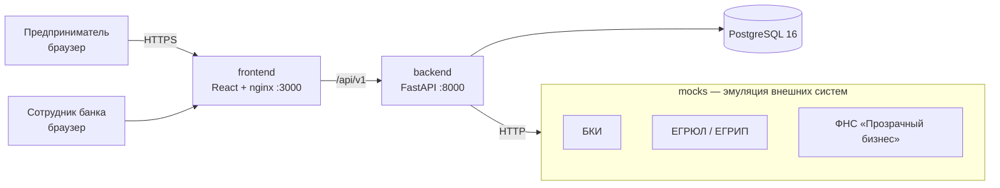

# Архитектура



## Компоненты

| Компонент | Технологии | Ответственность |
|---|---|---|
| `frontend` | React 18, TypeScript, Vite, nginx | Кабинет клиента, очередь банка; nginx проксирует `/api` |
| `backend` | Python 3.12, FastAPI, SQLAlchemy 2 | API, машина состояний, конвейер, скоринг, решение |
| `mocks` | Python 3.12, FastAPI | Упрощённые контракты БКИ, ЕГРЮЛ, ФНС на синтетических данных |
| `db` | PostgreSQL 16 | Компании, продукты, заявки, журнал событий |

## Слои backend

```
app/
  api/routes/      HTTP-слой: валидация входа, коды ответов
  services/
    state_machine  разрешённые переходы статусов
    pipeline       этапы конвейера: валидация → обогащение → скоринг → решение
    scoring        балльная модель (оценка риска)
    decision       кредитная логика (решение по оценке + продукту + стоп-факторам)
  integrations/    клиенты внешних систем
  models/          ORM-сущности
  schemas/         Pydantic-контракты API
```

## Решения и развитие

- **Синхронный конвейер** — для MVP заявка проходит этапы за один запрос `submit`. Следующий шаг: очередь (Redis/RabbitMQ) и воркеры на этап, чтобы падение внешнего сервиса не блокировало клиента.
- **Журнал событий** (`application_events`) — аудит каждого перехода с актором; основа таймлайна в UI.
- **Скоринг отделён от решения** — как требует кейс: одинаковый скор даёт разные условия для разных продуктов.
- TODO: аутентификация (JWT, роли client / underwriter), миграции Alembic, retry/circuit breaker для интеграций, метрики и трассировка.
