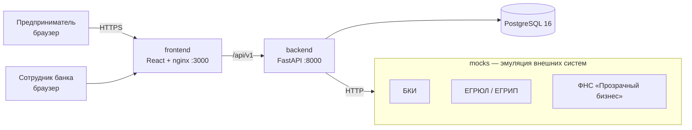

# Архитектура



## Компоненты

| Компонент | Технологии | Ответственность |
|---|---|---|
| `frontend` | React 18, TypeScript, Vite, nginx | Кабинет клиента и рабочее место андеррайтера; nginx проксирует `/api` |
| `backend` | Python 3.12, FastAPI, SQLAlchemy 2 | API, машина состояний, конвейер, скоринг, решение |
| `mocks` | Python 3.12, FastAPI | Упрощённые контракты БКИ, ЕГРЮЛ, ФНС на синтетических данных |
| `db` | PostgreSQL 16 | Компании, продукты, заявки, журнал событий |

## Слои backend

```
app/
  api/routes/      HTTP-слой: валидация входа, коды ответов
  api/deps.py      текущий пользователь, проверки ролей и доступа
  core/security.py токены и хеширование паролей
  services/
    state_machine  разрешённые переходы статусов
    pipeline       этапы конвейера: валидация → обогащение → скоринг → решение
    scoring        балльная модель (оценка риска)
    decision       кредитная логика (решение по оценке + продукту + стоп-факторам)
  integrations/    клиенты внешних систем
  models/          ORM-сущности
  schemas/         Pydantic-контракты API
```

## Решения и развитие

- **Синхронный конвейер** — для MVP заявка проходит этапы за один запрос `submit`. Следующий шаг: очередь (Redis/RabbitMQ) и воркеры на этап, чтобы падение внешнего сервиса не блокировало клиента.
- **Журнал событий** (`application_events`) — аудит каждого перехода с актором; основа таймлайна в UI.
- **Скоринг отделён от решения** — как требует кейс: одинаковый скор даёт разные условия для разных продуктов.
- **Транзакционность конвейера** — все этапы одной отправки выполняются в одной транзакции; при непредвиденной ошибке заявка откатывается в исходный статус и её можно отправить снова (`503` клиенту).
- **Отказоустойчивость интеграций** — таймаут и повторы (`INTEGRATION_TIMEOUT_S`, `INTEGRATION_RETRIES`); если источник так и не ответил, заявка уходит на ручной разбор с пометкой, какой источник недоступен.

## Безопасность

- Аутентификация: `POST /api/v1/auth/login` → токен `Authorization: Bearer` (HMAC-SHA256, срок жизни 12 ч), пароли — PBKDF2-SHA256 с солью. В продуктиве заменяется на корпоративный IdP (OIDC) без изменения контракта API.
- Авторизация по ролям: `client` — только заявки своей компании (чужие отдают `404`), `underwriter` — очередь и решения. Проверки — в `app/api/deps.py`.
- Все действия пишутся в журнал `application_events` с актором.
- Контейнер backend работает от непривилегированного пользователя.

## Следующие шаги

Миграции Alembic вместо `create_all`; очередь и воркеры на этап; circuit breaker; метрики (Prometheus) и трассировка (OpenTelemetry); загрузка и распознавание документов.
