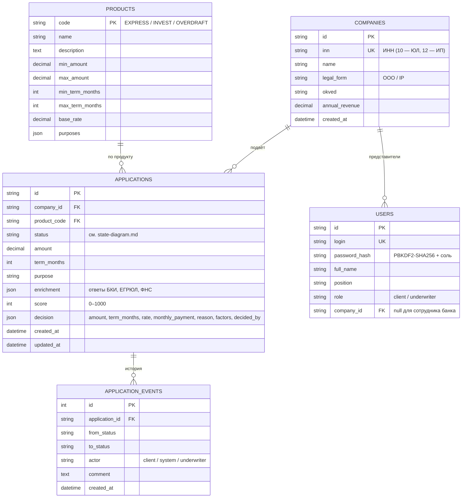

# Модель данных

Источник истины — `backend/app/models/entities.py`.

## Синтетические данные

- `backend/app/seed_data/products.json` — каталог продуктов.
- `backend/app/seed_data/companies.json` — 4 тестовых клиента под разные исходы.
- `backend/app/seed_data/users.json` — тестовые учётные записи (пароль `demo`).
- `mocks/app/data/registry.json` — ответы внешних систем по ИНН.
