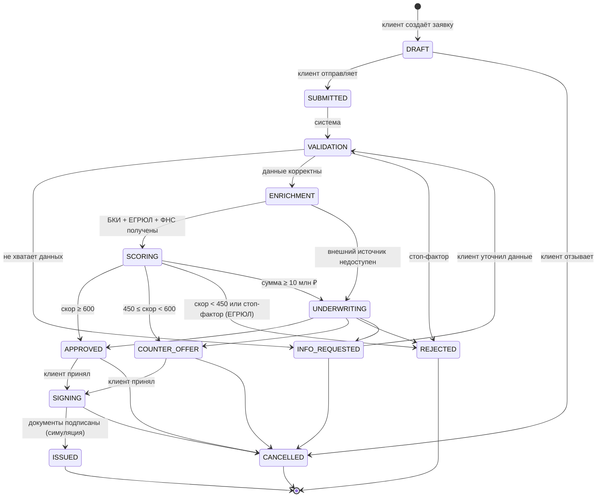

# Диаграмма состояний заявки

Источник истины — `backend/app/services/state_machine.py`. Любой переход вне таблицы возвращает `409 Conflict`.

| Статус | Кто действует | Что видит клиент |
|---|---|---|
| DRAFT | клиент | Черновик, можно редактировать |
| SUBMITTED / VALIDATION / ENRICHMENT / SCORING | система | «Заявка рассматривается», этап на таймлайне |
| INFO_REQUESTED | клиент | Что именно нужно уточнить |
| UNDERWRITING | андеррайтер | «Рассматривает специалист», статус обновляется автоматически |
| APPROVED / COUNTER_OFFER | клиент | Предложение: сумма, срок, ставка |
| SIGNING | клиент | Документы на подпись |
| ISSUED / REJECTED / CANCELLED | — | Итог |
